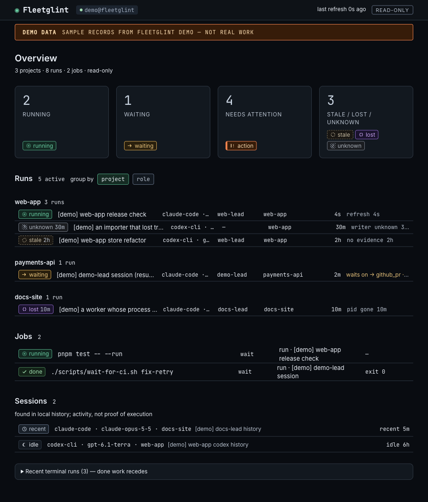

# Fleetglint



Fleetglint is a local, read-only board that shows what your AI agents are
doing, what the evidence actually proves, and what needs attention, without
taking over your workflow. It answers three questions: what is running, why it
is waiting, and who must act. It never schedules, dispatches or merges
anything, and it never writes back to the tools it reads.

## Install

Homebrew:

```sh
brew install nurockplayer/fleetglint/fleetglint
```

pipx:

```sh
pipx install https://github.com/nurockplayer/tachiko-fleetglint/releases/download/v0.1.0/fleetglint-0.1.0-py3-none-any.whl
```

Fleetglint needs Python 3.11 or later. It runs on macOS and Linux and has no
other dependencies. It is not on PyPI; the pipx command installs the release
wheel from GitHub.

## Quick start

```sh
fleetglint serve --open
```

This starts the board at `http://127.0.0.1:8765/` and opens it in your browser.
The server reads local files on a timer, so new records appear without a
restart.

On the first run:

- **With Claude Code or Codex history on this machine**, their adapters read it
  and list existing conversations as sessions. A session is shown as metadata:
  its agent, model, project, activity time and entry count. A history file is
  not proof that a process is running, so sessions are never shown as running.
- **With neither**, the board shows an empty state. It lists the places it
  looked and shows how to write a record.

`fleetglint doctor` prints the paths, permissions, what each adapter found and
the health of each source. It exits 1 when something needs fixing.

`fleetglint demo` writes a labelled sample workflow so you can see the board
with data. Demo records always carry `[demo]` in their titles and the board
shows a permanent DEMO DATA banner while they are present. `fleetglint demo
--clear` removes the demo source, and its rows leave the board on the next scan.

## What the states mean

Fleetglint keeps the state the writer recorded and shows a display state next
to it, computed from evidence. It never guesses that something is alive.

| State | What it means | Evidence Fleetglint needs |
|---|---|---|
| `running` | The agent is executing. | A local process check matched, or the writer refreshed the record within `stale_after_s`. |
| `waiting` | Started, but blocked on a job, a review or a person. | The same current evidence as `running`; `waits_on` says what it waits for. |
| `done` | The writer recorded success. | A terminal record. No liveness check. |
| `failed` | The writer recorded failure. | A terminal record. |
| `cancelled` | The writer recorded a deliberate stop. | A terminal record. |
| `stale` | A non-terminal record with no current evidence, and no local process to check. | `observed_at + stale_after_s` has passed. |
| `lost` | A local process check found the process gone, and no terminal record arrived. | The process id and start time no longer match a running process. |
| `unknown` | The writer could not tell, the source has a discontinuity, or an adapter reports it unavailable. | No usable evidence. |

Sessions have their own activity states:

| State | What it means | Evidence Fleetglint needs |
|---|---|---|
| `recent` | The history was active recently. | `last_activity_at` is within `stale_after_s`. |
| `idle` | The history has been quiet. | `last_activity_at` is older than `stale_after_s`. |
| `ended` | The tool recorded the end of the session. | A session-end event. |

A session is never counted as running, waiting, done or failed.

## Feed your own workflow

Write one complete record per line and pipe it to `fleetglint emit`:

```sh
fleetglint emit <<'JSON'
{"v":1,"type":"run","id":"worker-1","source_id":"my-workflow@workstation","updated_at":"2026-11-06T10:00:00+09:00","state":"running","agent":"claude-code","project":"payments-api","title":"Fix the retry loop","started_at":"2026-11-06T10:00:00+09:00"}
JSON
fleetglint emit <<'JSON'
{"v":1,"type":"run","id":"worker-1","source_id":"my-workflow@workstation","updated_at":"2026-11-06T10:30:00+09:00","state":"done","agent":"claude-code","project":"payments-api","title":"Fix the retry loop","started_at":"2026-11-06T10:00:00+09:00","ended_at":"2026-11-06T10:30:00+09:00"}
JSON
```

Each line is a full record. Sending the same id again replaces the previous
version. See [docs/emitting.md](docs/emitting.md) for jobs, inbox items,
heartbeats, Python examples and the exact file layout.

## Adapters

Fleetglint ships three read-only adapters. Each one is enabled automatically
when the files it reads are present. Set `enabled` to `"auto"` (default),
`"true"` or `"false"` in `config.toml` to change that.

| Adapter | Reads | Produces |
|---|---|---|
| tachiko-harness | `~/.local/state`: the worker ledger, detached job directories, wait markers and inbox files. | `run`, `job` and `inbox_item` records. |
| Claude Code | `~/.claude/projects/**/*.jsonl`, including subagent transcripts. | `session` records. |
| Codex | `~/.codex/sessions/**/rollout-*.jsonl` and `~/.codex/archived_sessions/**`. | `session` records. |

The transcript and rollout formats are not versioned by those tools, so these
importers are best effort and may skip lines they cannot parse. `fleetglint
doctor` reports what each scan found. Importers copy metadata only: ids, times,
model names, counts and token usage. They never copy prompts, model output,
tool input or output, file contents or full commands.

## Optional Claude Code hooks

Hooks are off by default. To record Claude Code session starts and ends as they
happen:

```sh
fleetglint hooks install claude
```

The command prints the diff for `~/.claude/settings.json` and asks before
writing; `--yes` skips the question. It adds entries for `SessionStart`,
`SessionEnd`, `SubagentStart` and `SubagentStop` that call `fleetglint hooks
record claude`. A backup of the previous file is written next to it as
`settings.json.fleetglint-backup-<timestamp>-<pid>`. The hook never blocks
Claude: it always exits 0 and has a 2-second budget.

To remove exactly the entries it added:

```sh
fleetglint hooks uninstall claude
```

> Do not install or remove hooks while Claude Code is changing its settings:
> Claude Code has no lock for settings.json, so a change made in the moment of
> the write can be lost. A backup of the previous file is kept next to it.

## Privacy and security

Fleetglint binds to `127.0.0.1` only, accepts `GET` and `HEAD` only, and checks
the `Host` header. It sends no telemetry and makes no outbound network
connections. Text is redacted before display. Files referenced by records are
opened only inside configured allowed roots, and only the last 64 KiB is read.
Everything is stored locally. [docs/privacy.md](docs/privacy.md) lists what is
read, what is stored and what is never copied.

## Compatibility

Records use format `v: 1`. Within v1, changes are additive: readers accept
unknown fields, and new optional fields, record types and free-form values do
not break older readers. Changing a closed enum value needs `v: 2`. A reader
that meets an unsupported version quarantines the line instead of guessing.

`fleetglint check FILE…` validates NDJSON files, or standard input when no file
is named. It prints `file:line: reason` for each bad line, ends with a count,
and exits 1 when any line is invalid.

CI tests Python 3.11 and 3.13 on Linux. macOS is tested on Python 3.13 for
pushes to `main`.

## Uninstall

1. Stop the service: press Ctrl-C in the terminal running `fleetglint serve`,
   or run `brew services stop fleetglint` if you started it as a service.
2. If you installed hooks, run `fleetglint hooks uninstall claude`.
3. Uninstall the package with `brew uninstall fleetglint` or
   `pipx uninstall fleetglint`.
4. Remove the state and config directories:

   ```sh
   rm -rf "${XDG_STATE_HOME:-$HOME/.local/state}/fleetglint" \
          "${XDG_CONFIG_HOME:-$HOME/.config}/fleetglint"
   ```

   These are the defaults when `XDG_STATE_HOME` and `XDG_CONFIG_HOME` are not
   set. The state directory holds the SQLite database, the NDJSON sources and
   the hook state. The config directory holds `config.toml`. Hook backups named
   `~/.claude/settings.json.fleetglint-backup-*` can be removed too.

## Scope and license

Fleetglint is not a scheduler, a terminal multiplexer or a merge tool. It does
not start, stop, retry, review or merge anything, and it does not monitor other
machines. v0.1 is deliberately local and read-only.

The record format is specified in [docs/spec.md](docs/spec.md). Fleetglint is
released under the MIT license; see [LICENSE](LICENSE).
